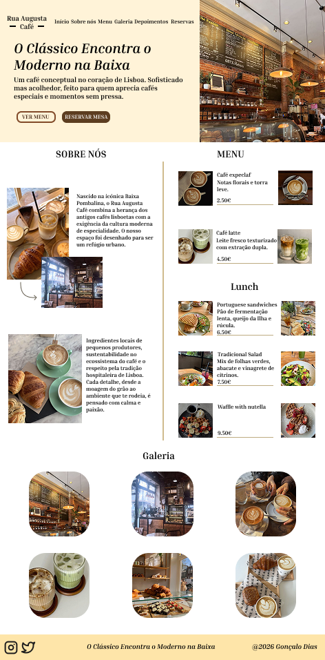

# Mockup de Site One Page – Rua Augusta Café

Mockup de um site de uma só página para um café fictício na Baixa de Lisboa, o Rua Augusta Café, feito no Figma. O site apresenta o espaço, o menu, uma galeria de fotografias e botões para ver o menu e reservar mesa.

**Ficheiro Figma:** [Abrir](https://www.figma.com/design/VPcN6fr1QWM0blvR6TRyBk/RUA-AUGUSTA-CAFE?node-id=0-1&t=SS6gMeTH5Ed12vYM-1)

## O que fiz
- Desenhei sozinho o mockup completo do site, de raiz.
- Criei três versões do layout: desktop, tablet (iPad Pro 11") e telemóvel (iPhone 16 & 17 Pro Max).
- Organizei a página em secções: início, sobre nós, menu, galeria e rodapé.

## Ecrãs

### Desktop

### Tablet

### Telemóvel

